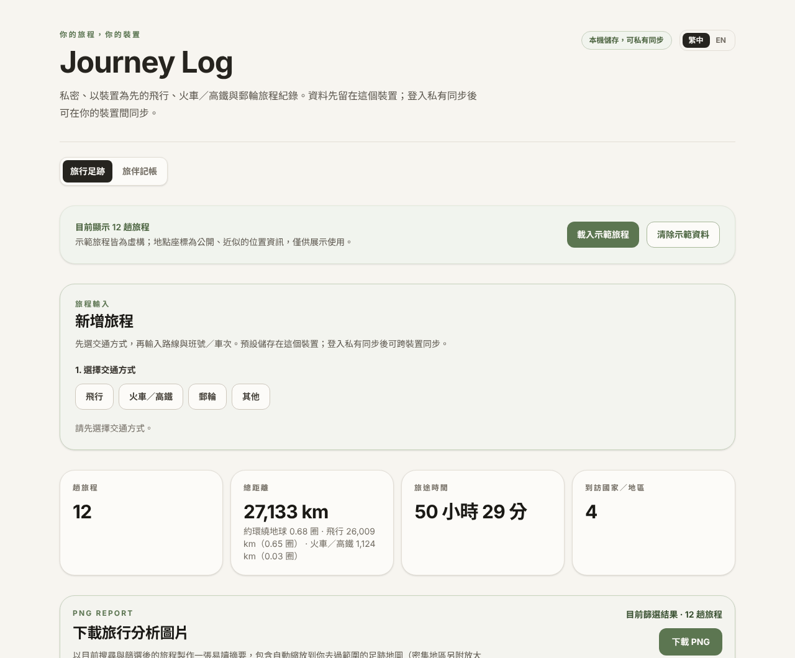
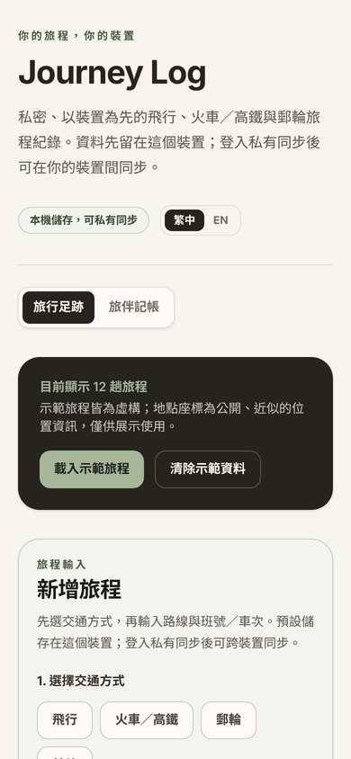
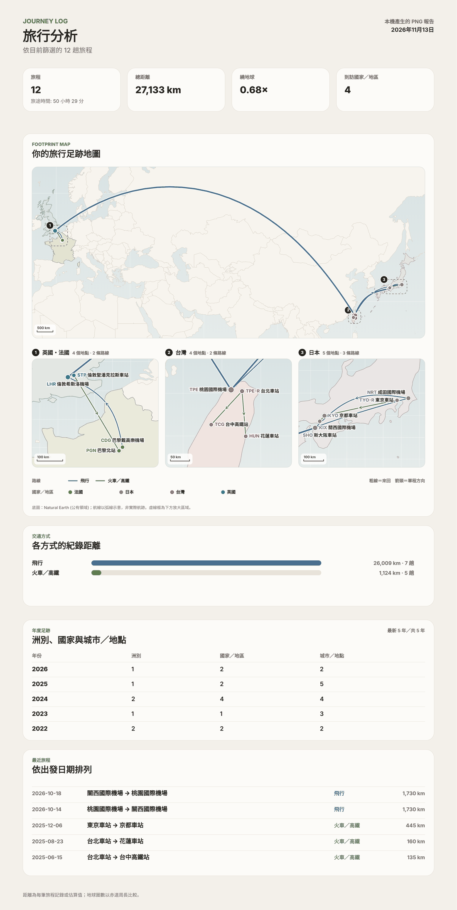
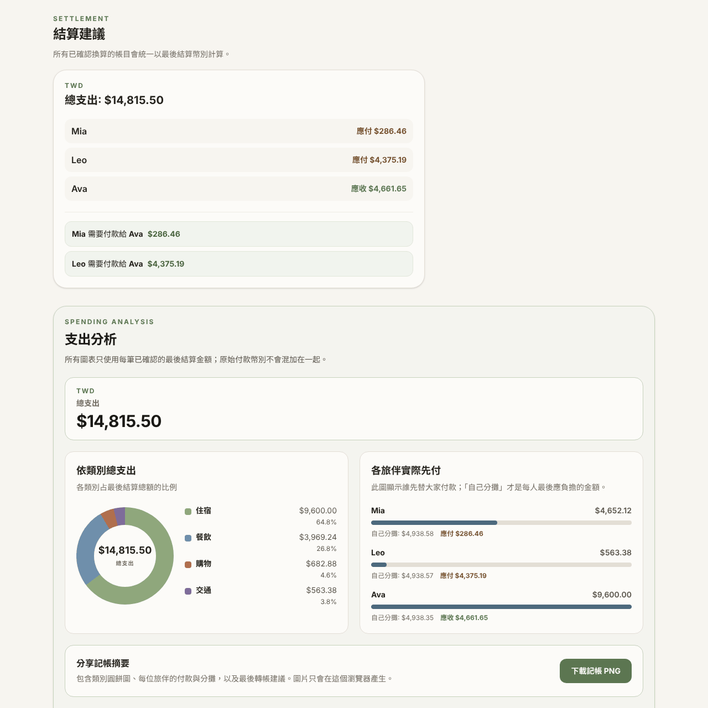
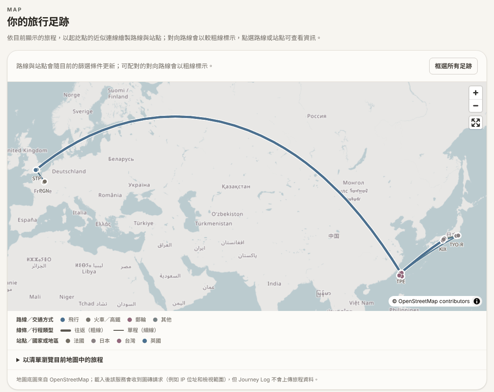

# Journey Log — travel tracker & trip expense splitter

**Live app:** https://journey-log-beta.vercel.app

Journey Log is a local-first, installable web app (PWA) for recording flights,
rail / high-speed rail, cruises and other journeys. It turns them into
statistics, an interactive route map and a shareable PNG recap, and includes a
multi-currency ledger for splitting travel expenses with friends. Data stays
on the device by default, with optional private cloud sync.

> 繁體中文簡介：Journey Log 是一個「資料先存在自己裝置」的旅程紀錄 App，可記錄飛行、火車／高鐵與郵輪，自動產生統計、互動路線地圖與可分享的足跡報告圖片，並內建多幣別旅伴分帳。可安裝到手機主畫面，也可選擇以 Email 驗證碼登入、在自己的裝置間私有同步。介面支援繁體中文與英文。

| Journeys & statistics | Phone (installable PWA) |
| --- | --- |
|  |  |

| Shareable PNG recap | Multi-currency expense settlement |
| --- | --- |
|  |  |



*Screenshots use the app's fictional sample data.*

## Features

- **Journey log** — flights, rail / high-speed rail, cruises and other trips,
  with autocomplete over ~9,800 airports and 76,000+ rail stations bundled
  with the app, operator recognition from flight / train numbers, and
  time-zone-aware durations (local departure and arrival times).
- **Flight lookup** — don't remember the flight number? Pick the route and
  date to list that day's flights (with codeshares and an airline filter);
  choosing one fills in the number, airline, times and aircraft. Optional,
  powered by AeroDataBox through a server-side route.
- **Statistics & filters** — distance, travel time, "laps of the Earth",
  countries and cities visited per year; multi-select filters by year, mode,
  continent, distance band and trip purpose, plus free-text search.
- **Maps** — an opt-in interactive MapLibre map, and a PNG recap whose
  footprint map fits itself to where you have travelled, adds numbered
  close-ups for dense regions, and tints visited countries (drawn entirely in
  the browser on a bundled Natural Earth basemap, so it also works offline).
- **Trip expense splitting** — expenses in any currency settle into one
  currency using a frozen per-expense exchange-rate snapshot (automatic
  reference rate or manual). Integer minor-unit arithmetic, deterministic
  rounding, a short list of suggested transfers, and spending charts.
- **Local-first & private** — IndexedDB storage, works offline as an
  installable PWA; optional Supabase sync with Row Level Security and
  revision-checked, conflict-aware merging (never silent overwrites).
- **Bilingual** — every screen in Traditional Chinese and English.

## Tech stack

Next.js 16 (App Router) · React 19 · TypeScript (strict) · Tailwind CSS 4 ·
Dexie / IndexedDB · Zod · MapLibre GL · Recharts · Canvas 2D (report
rendering) · Supabase (Postgres, Auth, RLS) · Vitest · Vercel

## Engineering highlights

- **Business logic in `src/lib/` with unit tests** (28 test files): distance
  and great-circle routes, time zones and local dates, statistics, settlement,
  exact decimal currency conversion with `BigInt`, sync merging, map
  projection and region clustering.
- **Money is never a float.** Amounts are stored in minor units; conversions
  use exact rational arithmetic and largest-remainder allocation so shares
  always add up to the total.
- **Report map** — a fitted Web-Mercator projection that chooses its central
  meridian from the largest empty longitude gap (so trans-Pacific routes are
  not split), single-linkage clustering to decide which regions get
  close-ups, and collision-aware label placement.
- **Sync safety** — every cloud write is revision-checked in a Postgres
  function; a concurrent edit is surfaced for the person to resolve, and
  deletions leave a minimal tombstone so other devices learn about them.
- **Privacy by design** — no third-party request is made until the person
  opts in (map tiles, exchange rates); place search runs against bundled data.

## How this was built

This is a personal portfolio project developed with AI coding agents (OpenAI
Codex and Anthropic Claude). I defined the product and its requirements,
directed the design decisions, and reviewed and tested the results; the
project rules the agents follow are in [`AGENTS.md`](AGENTS.md).

## Run it locally

Use pnpm (the project is pinned to pnpm 11.25.0):

```bash
pnpm install --frozen-lockfile
pnpm dev
```

Open the address printed by the development server, normally
`http://localhost:3000`.

To preview the installable production build locally, run `pnpm build` followed
by `pnpm start`. Browsers treat `localhost` as secure for development; phones
need an HTTPS deployment before installation is offered.

## Quality checks

```bash
pnpm lint
pnpm typecheck
pnpm test
pnpm build
```

## Data and privacy

- Journeys, custom places, and the expense ledger are stored in this browser's
  IndexedDB database, so the app remains useful offline.
- Optional private sync is available after Supabase is configured. A person
  signs in with an emailed Magic Link by default, or an emailed verification
  code when their Supabase email template is configured for it. Supabase Row
  Level Security makes every cloud record available only to that signed-in
  account. The app uses HTTPS in transit and does **not** claim end-to-end
  encryption.
- The first cloud sync is an explicit action. It compares this device and the
  cloud before uploading; ordinary records use their newest `updated_at`
  value, and a concurrent edit is left for the person to choose rather than
  silently overwriting either copy. Sample journeys are never uploaded.
- Signing out pauses cloud replication but intentionally leaves the device's
  offline copy (and any later local changes) in place. Those changes do not
  upload until the same account explicitly re-enables sync. Use a separate
  browser profile on a shared computer.
- A cloud deletion immediately redacts the journey or expense payload. A small
  tombstone containing its identifier, revision, and timestamps remains so
  that other signed-in devices can learn that the record was deleted.
- The interactive map is opt-in. Loading it fetches map tiles from
  OpenStreetMap; the app does not send journey records to OpenStreetMap.
- Exchange-rate lookup is also opt-in. When requested, only the source/target
  currency pair and date are sent to the app's rate endpoint; confirmed rates
  are saved with each expense as an immutable snapshot.
- Airport and rail-station autocomplete searches the app's bundled reference
  data through its own route. Typed place names and codes are not sent to an
  external geocoder or timetable provider. Airport data is from
  [OurAirports](https://ourairports.com/data/) (Public Domain); station data is
  from [GeoNames](https://www.geonames.org/export/) (CC BY 4.0). The local
  index is a travel-recording aid, not a live timetable or an official
  operational directory.
- The journey dashboard can create a PNG recap for the currently visible
  journeys, including a footprint map drawn in the browser on a bundled
  Natural Earth basemap. The map fits itself to the visible journeys and adds
  enlarged panels for compact regions (for example domestic rail trips next to
  long-haul flights); a fully converted expense ledger can create a PNG
  spending recap. These images are generated locally only after the person
  chooses to download them; they are sharing snapshots, not a restorable data
  backup.
- Clearing browser site data removes local records. Keep important source
  records elsewhere until a full backup/import feature is added.

## Set up private cloud sync

1. Create a Supabase project, then run
   [`supabase/migrations/202611110001_private_sync.sql`](supabase/migrations/202611110001_private_sync.sql)
   in its SQL editor (or apply it with the Supabase CLI). It creates the
   journey tables, revision-checked sync functions, and owner-only RLS rules.
2. In Supabase Authentication, enable Email sign-in and choose the email
   sign-in format that fits the app you will use. **Before sharing the app with
   anyone outside your Supabase team, configure a transactional SMTP provider**
   (such as Resend, Postmark, or SES), verify its sender, and set an
   appropriate Auth email rate limit. Supabase's built-in sender is only for
   testing: it permits project team addresses and has a project-wide limit of
   two emails per hour.

   - **Default Magic Link (no extra email setup):** leave the default template
     unchanged. The sign-in email opens a link that returns to Journey Log in
     the same browser.
   - **Verification code (best for an installed iPhone/iPad app):** use a
     Supabase email configuration that permits custom templates, such as custom
     SMTP, then change the **Magic Link** template to send a code instead of a
     link. For example, its body can be
     `<p>Your Journey Log sign-in code: {{ .Token }}</p>`; do not include
     `{{ .ConfirmationURL }}`. The app accepts the code in place of a link.

   With the default free Supabase email service, newly created projects cannot
   customise the template. Its Magic Link works in a regular phone browser,
   but on iPhone/iPad a link opened in Safari does not sign an already-installed
   Home Screen app into its separate storage. Use the verification-code setup
   if that installed app needs cloud sync.
3. Copy `.env.example` to `.env.local` and fill in the Project URL plus the
   browser-safe **publishable** key from Supabase. Never use a service-role
   key in the app or in Vercel.
4. In Supabase Authentication URL Configuration, add
   `http://localhost:3000` to **Redirect URLs** for local testing. After your
   HTTPS deployment exists, set its exact URL as the **Site URL** and add it to
   **Redirect URLs** as well. This allows Magic Links to return to the app.
5. Restart the local server, open either app page, and use **Private sync** to
   request a sign-in email. Open a Magic Link in the same browser, or enter its
   verification code when the email provides one. First sync is deliberately
   opt-in.

## Optional: flight lookup

The journey form can list the flights on a route and date. It is hidden
unless a server-side key is configured:

1. Get an AeroDataBox API key (directly from AeroDataBox, or through the
   RapidAPI / API.Market marketplaces) on a plan that includes API units.
2. In Vercel (and `.env.local` for local work) set `AERODATABOX_API_KEY`. If
   the key comes from a marketplace, also set `AERODATABOX_PROVIDER` to
   `rapidapi` or `apimarket`. Never use a `NEXT_PUBLIC_` name for this key.
3. Each lookup uses two requests (AeroDataBox limits a query to 12 hours);
   results are cached for six hours. Only the two airport codes and the date
   are sent; when the quota is used up the form says so and manual entry keeps
   working.

## Deploy an installable private app

1. Import this repository into Vercel and deploy it. Vercel provides an HTTPS
   `*.vercel.app` URL automatically; a custom domain can be attached later.
2. Add `NEXT_PUBLIC_SUPABASE_URL` and
   `NEXT_PUBLIC_SUPABASE_PUBLISHABLE_KEY` in the Vercel Production environment,
   then deploy. Once Vercel gives the final HTTPS URL, add that exact URL to
   Supabase Authentication's **Site URL** and **Redirect URLs** before signing
   in. It is where a default Magic Link returns.
3. Visit the HTTPS URL on a phone. Android browsers show **Install Journey
   Log** when eligible. On iPhone or iPad, open it in Safari, use Share, then
   choose **Add to Home Screen**. For cloud sync in an installed iPhone/iPad
   app, use the verification-code email setup described above; the default
   Magic Link instead signs in the Safari browser.

The URL itself remains reachable so that the PWA and sign-in page can load;
the private part is the account-protected data. Do not rely on a hidden URL as
the privacy boundary.

## What sharing means today

Publishing the URL lets other people create their **own private Journey Log
accounts** once SMTP is configured. Row Level Security keeps one account's
cloud records invisible to every other account. It does not yet provide a
shared trip, joint ledger, invitations, or member-level permissions across
different accounts; those require an explicit collaborative-workspace feature
rather than sharing a login.

## Development notes

The bundled global reference index currently contains airports with common
aviation codes and more than 70,000 rail stations. Rail stations do not have a
single worldwide code system, so source-only station IDs are never shown as
traveller-facing codes. If a place is missing or needs correcting, add it in
the journey form with its IANA time zone, coordinates, and continent. The
saved-custom-places section later lets you correct an older place's continent;
linked journey endpoints update together so filtering remains consistent.
